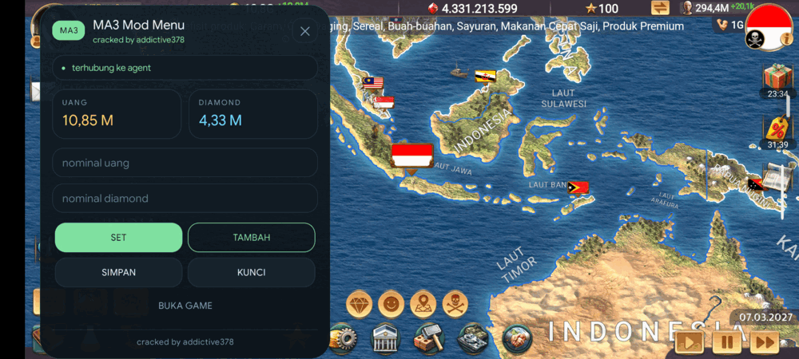
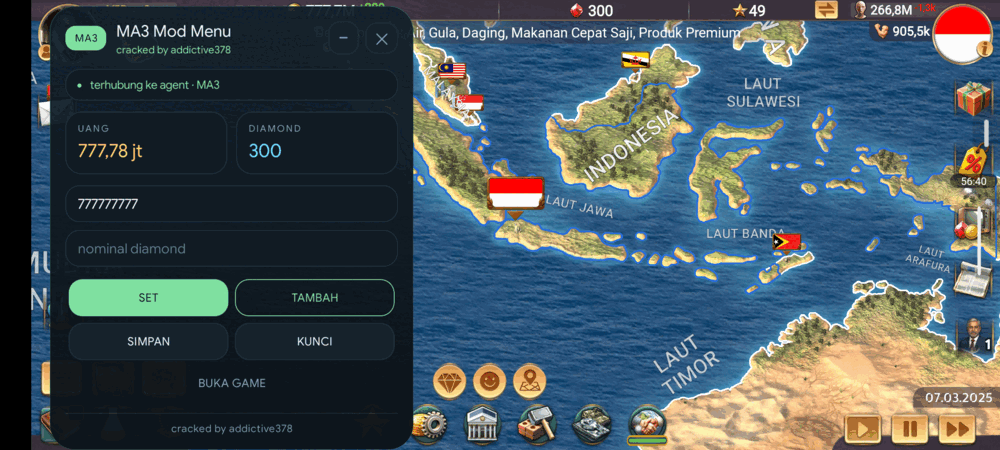

# MA3 Mod Menu

Panel melayang untuk **Modern Age 3** (Age of History 3) yang bisa membaca dan
mengubah **uang (GOLD)** dan **diamond (CRISTAL)** langsung dari dalam game.

- **cracked by addictive378**
- Butuh **root** (KernelSU / Magisk). Tanpa root tidak bisa — lihat
  [Batasan](#batasan).
- Tanpa LSPosed/Xposed. Agent memakai **JNI mentah** lewat Frida, jadi ART
  tidak dipatch dan PairIP tidak terpicu.

| Panel | Minimize | Set nilai |
|---|---|---|
|  |  |  |

## Fitur

- Baca nilai uang & diamond secara langsung (polling ~2 detik).
- **SET** (set persis), **TAMBAH**, **SIMPAN** (paksa save), **KUNCI** (jaga
  nilai agar tidak turun).
- **Minimize**: panel mengecil jadi pil kecil `MA3 2,35 M · 2` yang bisa
  digeser; ketuk untuk membuka lagi. Tidak menutupi layar game.
- Mendukung dua varian game sekaligus:
  - `com.oxiwyle.modernage3premium`
  - `com.oxiwyle.modernage3`

  Panel mendeteksi sendiri game yang sedang berjalan.
- Pemasangan otomatis: agent dan `frida-inject` disalin sendiri, sesi agent
  dipasang ulang otomatis kalau habis.

## Syarat

| Syarat | Keterangan |
|---|---|
| Root | KernelSU atau Magisk. Diuji di Android 16 + KernelSU. |
| Android 8+ | Panel memakai `TYPE_APPLICATION_OVERLAY`. |
| Izin "tampilkan di atas aplikasi lain" | Diminta saat pertama kali. |
| Game Modern Age 3 terpasang | Versi premium atau biasa. |

## Pasang (pengguna)

1. Unduh `ma3overlay.apk` dari halaman **Releases**, lalu install.
2. Buka aplikasi **MA3 Mod Menu**. Di kartu **KESIAPAN** akan terlihat apa yang
   masih kurang.
3. Kalau **Helper root** masih *belum*: tekan **Salin perintah helper root**,
   tempel di Termux (root), jalankan sekali. Lalu tekan **Periksa ulang**.
   *(Kalau perangkatmu mengizinkan `su` langsung, langkah ini tidak perlu.)*
4. Tekan **Pasang komponen** — `frida-inject` disalin dari dalam APK ke
   `/data/local/tmp`.
5. Tekan **Tampilkan panel**, lalu **BUKA GAME** di panel.

Setelah itu pemakaian harian cukup: buka app → **Tampilkan panel** →
**BUKA GAME**.

### Pasang lewat adb (opsional)

```bash
./install.sh ma3tool/android/ma3overlay.apk
```

Skrip ini meng-install APK, menaruh helper root di `/data/adb/service.d/`, dan
menjalankannya. `frida-inject` tetap disalin dari dalam APK lewat tombol
**Pasang komponen**.

## Build dari sumber

Butuh: JDK 17+, Android SDK (build-tools + `android.jar`), `adb` untuk uji.

```bash
# 1. ambil frida-inject (sekali saja, ~57 MB)
./ma3tool/tools/get-frida-inject.sh

# 2. build APK tanpa Gradle
cd ma3tool/android && ./build.sh
# hasil: ma3tool/android/ma3overlay.apk
```

`build.sh` memakai `javac → d8 → aapt2 → zipalign → apksigner`, dan membuat
keystore sendiri di `build/` kalau belum ada.

## Cara kerja (ringkas)

```
APK overlay ──tulis cmd──► ma3root.sh (root, service.d) ──exec──► frida-inject
     │  ◄──res── (file channel)                                      │
     └────────── TCP 127.0.0.1:47321..47330 ──────────────────────────┘
                                                                     │
                              agent JNI mentah di dalam proses game ◄─┘
```

- Aplikasi tidak memegang root; ia menumpang helper `ma3root.sh` (atau `su`
  langsung bila tersedia).
- Agent tidak memakai `frida-java-bridge` (yang mem-patch ART dan memicu
  PairIP), tetapi memanggil `JNIEnv` lewat `NativeFunction`.
- Semua referensi Java di-resolve ulang tiap permintaan supaya tidak basi.
- Inject baru dilakukan setelah proses game berumur ≥ 25 detik; inject terlalu
  awal membuat sesi rusak permanen.

Detail teknis lengkap: [`docs/ANALISIS.md`](docs/ANALISIS.md).

## Batasan

- **Wajib root.** Tanpa root, satu-satunya jalur adalah mem-patch APK game
  (risiko PairIP + save hilang saat re-sign), dan itu di luar cakupan proyek ini.
- Sesi agent berumur terbatas; panel memasang sesi baru otomatis (ada jeda
  beberapa detik saat pergantian).
- Kalau game di-update dan PairIP berubah, perilaku bisa ikut berubah.
- Gunakan di save/akun sendiri. Risiko ditanggung pengguna.

## Lisensi

Kode proyek ini: **MIT** — lihat [`LICENSE`](LICENSE).

Rilis APK membundel `frida-inject` dari [Frida](https://frida.re) yang
berlisensi **wxWindows Library Licence** (LGPL-style). Binary itu bukan karya
proyek ini; sumber dan lisensinya ada di repositori Frida. Lihat
[`THIRD_PARTY.md`](THIRD_PARTY.md).

---

### English (short)

MA3 Mod Menu is a rooted-Android overlay for **Modern Age 3** that reads and
writes the player's gold and diamonds through raw JNI calls injected with
Frida (no LSPosed, no ART patching). Requires root; supports both
`com.oxiwyle.modernage3premium` and `com.oxiwyle.modernage3`. Install the APK,
run the one-line root helper command once, press **Pasang komponen**, then
**Tampilkan panel**. MIT licensed; the release APK bundles `frida-inject`
(wxWindows Library Licence).
